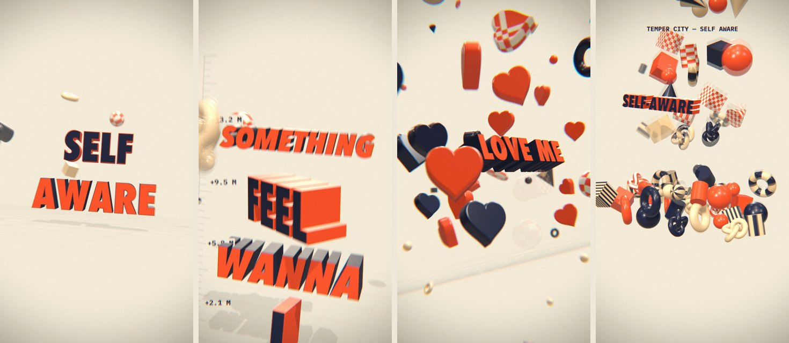

# lyric-3d-video — a Claude Code skill

Give Claude a song and its lyrics; get back a vertical (9:16) 3D kinetic-typography lyric video where every
sung word lands as a real extruded 3D object, on the beat.



What it builds:
- **Word-level sync** — every lyric word is aligned to the moment it is sung (whisper + onset snapping).
- **Beat-locked** — tempo, downbeat and the chorus drop are detected; cuts, camera hits and effects land on the grid.
- **Real 3D type** — letters extruded from fonts with bevels, clearcoat and shadows; they sway so you see their depth.
- **Camera & lens** — 10-subframe motion blur, thin-lens depth of field, whip cuts, shake and zoom-blur on hits.
- **A world** — glossy 3D elements around the words, a drop shockwave, lyric-tied objects, a physics pile finale.
- **Audio-reactive** — the kick and hi-hat drive lens punches, aberration and element pulses.
- **Delivery** — a master render plus a <30 MB upload copy and a no-music copy.

## Install
```bash
git clone https://github.com/innonkaduri/lyric-3d-video ~/.claude/skills/lyric-3d-video
```
Then in Claude Code just ask: *"make a 3D lyric video for the chorus of this song"* and give it the audio file and the lyrics.

## Requirements
- **macOS** (the 3D letters are generated from fonts that ship with macOS: Futura, Avenir Next Condensed, Bodoni 72,
  SignPainter, Arial Rounded — nothing font-related is redistributed here)
- [Claude Code](https://claude.com/claude-code)
- `ffmpeg`
- `whisper-cli` ([whisper.cpp](https://github.com/ggml-org/whisper.cpp)) with `ggml-large-v3.bin` in `~/.cache/hyperframes/whisper/models/`
- Python 3 with `librosa soundfile numpy fonttools`
- Node.js (rendering runs through [HyperFrames](https://hyperframes.heygen.com) via `npx`)

Rendering is local and heavy: about 7 minutes for 40 seconds of video on an Apple-silicon Mac.

## Notes
- **Lyrics are yours to supply.** The skill never writes song lyrics on its own — it uses the lyrics you give it.
- **Music rights:** platforms may mute uploads that contain copyrighted songs. The skill also outputs a no-music
  copy so you can add the track from the platform's own music library.
- The shipped engine is tuned for a 12-line pre-chorus + chorus; `references/engine.md` explains how to fit any song.

## License
MIT for this skill's code (see `LICENSE`). Bundled third-party libraries keep their own licenses — see `THIRD_PARTY.md`.
